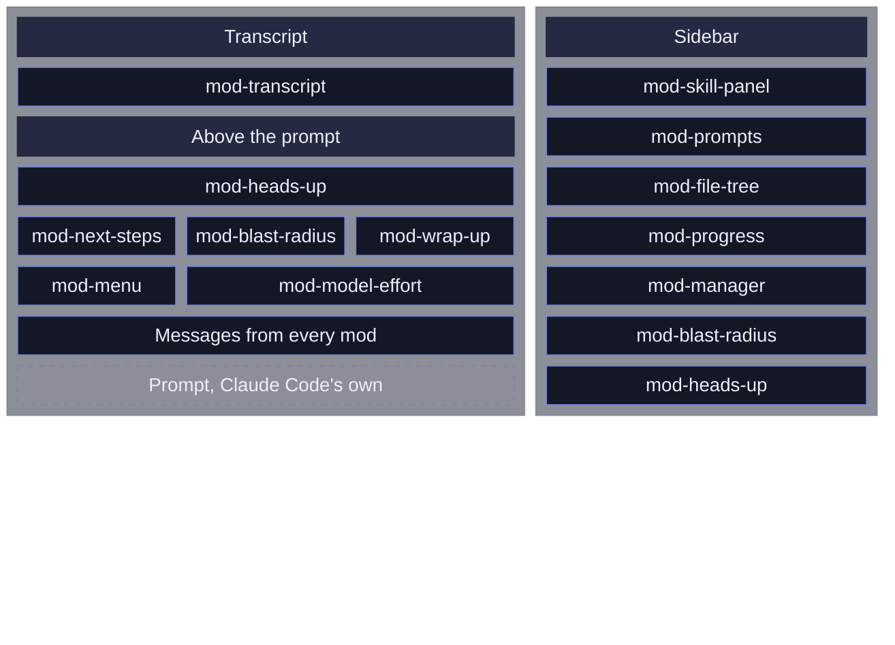
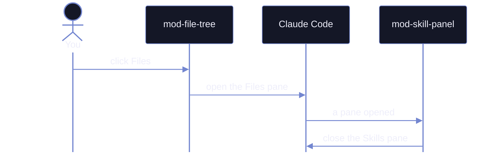

<div align="center">
  
</div>

# moonlight-claude-mods

Add-ons for the Claude Code terminal that add panels, safety checks and pills (small clickable labels in a row above the prompt). One more mod styles the desktop app. They need Claude Code 2.1.287 or newer, and they are tested on Windows Terminal and macOS iTerm2.

## Install

> [!WARNING]
> Mods are not sandboxed: they run with your permissions.

Not sure which ones you want? Start with mod-manager. It lists every mod, installs the ones you tick, turns them on and off, and tells you when there are updates. From your terminal:

```sh
claude plugin install mod-manager --marketplace v-amorim/moonlight-claude-mods
```

Then start Claude Code, and click Open setup on the card above the prompt, or the gear pill.

One mod, inside Claude Code, using any name from [the list of mods][doc-mods]:

```text
/plugin marketplace add v-amorim/moonlight-claude-mods
/plugin install mod-transcript@claude-mods
/reload-plugins
```

`/plugin install` asks where to install the mod. Keep Install for you (user scope) and press Enter, then press Esc to leave the plugin screen before `/reload-plugins`.

<details>
<summary>All of them at once, from your terminal</summary>

1. Add this repo as a plugin marketplace:

   ```sh
   claude plugin marketplace add v-amorim/moonlight-claude-mods
   ```

2. Install every mod. In bash or zsh:

   ```sh
   for mod in mod-menu mod-manager mod-skill-panel mod-prompts mod-file-tree mod-transcript mod-model-effort mod-heads-up mod-progress mod-next-steps mod-wrap-up mod-blast-radius mod-collision-guard; do
     claude plugin install "$mod@claude-mods" --scope user
   done
   ```

   In PowerShell:

   ```powershell
   'mod-menu','mod-manager','mod-skill-panel','mod-prompts','mod-file-tree','mod-transcript','mod-model-effort','mod-heads-up','mod-progress','mod-next-steps','mod-wrap-up','mod-blast-radius','mod-collision-guard' | ForEach-Object { claude plugin install "$_@claude-mods" --scope user }
   ```

   Each install may print how many of the mod's settings are not set yet. You can ignore that: every setting has a default.

3. Run `/reload-plugins` in an open session, or start a new one.

</details>

Each mod works alone. Add `mod-manager` too if you want the gear pill, which installs, turns on and off, and updates mods, and opens every mod's settings in one place.

This marketplace doesn't update on its own. Claude Code turns auto-update on only for official marketplaces. mod-manager shows a card when mods have updates, or turn auto-update on in `/plugin`, under Marketplaces, then `claude-mods`.

## See them in action

| Every terminal mod in 133 seconds |
| --- |
| https://github.com/user-attachments/assets/d2fd0a54-b9ac-489b-830d-72833fa6e85c |

| Without mods | With mods |
| --- | --- |
| ![][img-plain] | ![][img-with-mods] |

## What each mod does

Click a name for its screenshots, features and settings.

| Mod | What it does | How to open it |
| --- | --- | --- |
| [`mod-menu`][doc-mod-menu] | The switch that hides or shows the pill row above the prompt, plus its hover tips; each panel mod draws its own pill | `/mod-menu` |
| [`mod-manager`][doc-mod-manager] | Installs, turns on and off, and updates mods, and edits their settings | The gear pill, or `/mod-manager` |
| [`mod-skill-panel`][doc-mod-skill-panel] | Lists your skills and agents; a click adds one to the prompt | Skills pill |
| [`mod-prompts`][doc-mod-prompts] | Every prompt of the session; jump back to any of them | Prompts pill |
| [`mod-file-tree`][doc-mod-file-tree] | The files Claude read and changed, with a replay of each edit | Files pill |
| [`mod-transcript`][doc-mod-transcript] | Chat bubbles for you and Claude, each finished turn folded to one line you can open, Bash commands in shell colors | Automatic |
| [`mod-model-effort`][doc-mod-model-effort] | Shows the model and effort level; a click changes either | The model pill |
| [`mod-heads-up`][doc-mod-heads-up] | Now and then flags one thing you should know but might miss, kept by turn in a panel | Automatic, or the Heads up pill |
| [`mod-progress`][doc-mod-progress] | The main session, every subagent and every agent of a workflow run: model, effort, context fill, tokens, time, and gate progress when a skill writes a `GATES.md` under `~/.claude/gates/<repo>/<session id>`, plus the background shells and monitors each one started, with their live output | Progress pill |
| [`mod-next-steps`][doc-mod-next-steps] | Suggests up to three next prompts after each turn | Automatic |
| [`mod-wrap-up`][doc-mod-wrap-up] | Hands off to a fresh session, or fills `/compact` with what to keep | Wrap up pill |
| [`mod-blast-radius`][doc-mod-blast-radius] | Holds a risky shell command until you choose Cancel or Run | Automatic |
| [`mod-collision-guard`][doc-mod-collision-guard] | Asks before editing a file another session just changed | Automatic |

Where each mod draws on the screen:



## Icons and Nerd Fonts

The mods draw safe Unicode symbols, so they work in any terminal. With a Nerd Font they show sharper icons instead. You don't need one.

| Without a Nerd Font | With a Nerd Font |
| --- | --- |
| ![][img-icons-plain] | ![][img-icons-nerd] |

With the font, pills are round and every tab has a real icon.

A Nerd Font is a programming font with thousands of icons added to it. To use one:

1. Download one from [nerdfonts.com][nerd-fonts], such as JetBrainsMono Nerd Font, and install it.
2. Set it as your terminal's font. In Windows Terminal, that's Settings, then your profile, Appearance, Font face.
3. Start a new Claude Code session.

The mods find the font on their own in Windows Terminal, iTerm2, VS Code, Ghostty, kitty, WezTerm, Alacritty, GNOME Terminal and Konsole. In any other terminal, set the Icons setting from `auto` to `nerd`: for all mods at once from the gear pill, or per mod with `/mod-<name> settings`.

## Each mod up close

Click a mod to open its screenshots and video. Each block ends with a link to the mod's full page.

<!-- showcase:start -->

<details>
<summary><b>mod-menu</b>: Each panel mod draws its own pill in one row. Hover one to see what it does.</summary>

| Hovering an entry shows its tip |
| --- |
| https://github.com/user-attachments/assets/b385c49e-a298-4594-98fd-8e620150e3e2 |

[Full page][doc-mod-menu]

</details>

<details>
<summary><b>mod-manager</b>: Hover a mod to read about it, switch every mod's icons at once, and apply a toggle.</summary>

| Hover a mod, switch the icons |
| --- |
| https://github.com/user-attachments/assets/3eb36efb-13ef-4859-86e9-592eeb9f6060 |

[Full page][doc-mod-manager]

</details>

<details>
<summary><b>mod-file-tree</b>: The files Claude touches, colored by what happened to them.</summary>

| Live while Claude works |
| --- |
| https://github.com/user-attachments/assets/da738c8d-4dda-4ed3-a6a3-fb6d2e8fe72e |

[Full page][doc-mod-file-tree]

</details>

<details>
<summary><b>mod-next-steps</b>: Up to three next prompts. Click one, or type its number, to fill the prompt.</summary>

| Picking one by its digit |
| --- |
| https://github.com/user-attachments/assets/c6eba33e-5ebf-4e3f-b30d-514da45b0319 |

[Full page][doc-mod-next-steps]

</details>

<details>
<summary><b>mod-prompts</b>: Every prompt of the session; pick one to read it again.</summary>

| Pick a prompt to read it |
| --- |
| https://github.com/user-attachments/assets/94884a8e-62d4-4605-af19-591ab12e8adb |

[Full page][doc-mod-prompts]

</details>

<details>
<summary><b>mod-skill-panel</b>: Your skills grouped by color; click one to add it to the prompt.</summary>

| Tags while typing /, add a skill, then the settings |
| --- |
| https://github.com/user-attachments/assets/c26f35ef-db0a-4450-8dc0-f4972a9eba89 |

[Full page][doc-mod-skill-panel]

</details>

<details>
<summary><b>mod-transcript</b>: Each finished turn folds to one line; open it to see every step, or copy a reply from its bottom edge, which marks what each choice takes. A reply that names hex colors shows them.</summary>

| Unfolding a turn |
| --- |
| https://github.com/user-attachments/assets/f4310ccc-c80d-48b4-ae0d-9a6f0fad2efe |

[Full page][doc-mod-transcript]

</details>

<details>
<summary><b>mod-model-effort</b>: The model and its effort level, one click to change.</summary>

| Effort on hover, models on click |
| --- |
| https://github.com/user-attachments/assets/6eb5747c-7a7d-4546-b8d0-512a0464c96d |

[Full page][doc-mod-model-effort]

</details>

<details>
<summary><b>mod-heads-up</b>: Now and then, one thing you should know; every note stays in its panel.</summary>

| The panel and a note opened |
| --- |
| https://github.com/user-attachments/assets/39ddfb43-7ad3-4e98-a3c1-4e6fa8a44c23 |

[Full page][doc-mod-heads-up]

</details>

<details>
<summary><b>mod-progress</b>: Every agent at a glance: its current step, model, effort, context, tokens, time and gates, with the background shells it started. A click on a shell opens its full command and live output.</summary>

| Two agents running, opened from the pill |
| --- |
| https://github.com/user-attachments/assets/4339b8da-f37d-4ad3-ba5a-2bd5f93b9e76 |

[Full page][doc-mod-progress]

</details>

<details>
<summary><b>mod-blast-radius</b>: A risky command waits for your answer. Type 1, 2 or 3 into the empty prompt, or click.</summary>

| A risky command held |
| --- |
| https://github.com/user-attachments/assets/e98ac88c-e06f-4bc5-a2b6-a690009d9208 |

[Full page][doc-mod-blast-radius]

</details>

<details>
<summary><b>mod-collision-guard</b>: Another session just edited this file, so Claude asks first.</summary>

| Asking before an edit |
| --- |
| ![][img-collision-guard] |

[Full page][doc-mod-collision-guard]

</details>

<details>
<summary><b>mod-wrap-up</b>: Pick what carries over, then hand off or compact; past a context mark it hands off by itself. Played at double speed.</summary>

| Compact, start to end |
| --- |
| https://github.com/user-attachments/assets/1d4a0d56-3999-42f4-b990-8428403b9db0 |

| Auto handoff at the mark: countdown, clear, carry on |
| --- |
| https://github.com/user-attachments/assets/124db9fa-76f6-4a4b-8117-904c42a7bdb8 |

[Full page][doc-mod-wrap-up]

</details>

<!-- showcase:end -->

## Everyday use

| Goal | How |
| --- | --- |
| Turn one off, or change its settings | The gear pill, or `/mod-<name> settings` |
| Apply changes in an open session | `/reload-plugins` |
| Update to the latest version | `claude plugin update <name>@claude-mods` |
| Try one mod without installing it | `git clone https://github.com/v-amorim/moonlight-claude-mods`, then `claude --plugin-dir ./moonlight-claude-mods/mod-transcript` |
| Load the clone in every session | Add each mod folder of the clone to `env.CLAUDE_CODE_PLUGIN_DIRS` in `~/.claude/settings.json`, separated by `;` on Windows and `:` elsewhere |
| Pass a slash command from Git Bash | `MSYS_NO_PATHCONV=1 claude "/mod-<name> settings"`, since Git Bash rewrites `/x` into a Windows path |

## License and credits

Made by [Vinicius Amorim][author] and released under the [MIT license][license]. Bug reports and pull requests are welcome, especially from Linux terminals, which are untested.

## Build your own

<details>
<summary>Make a new mod</summary>

1. Clone the repo, then copy an existing mod's folder to `<clone>/<name>` and rename it in `plugin.json` and its test.
2. Check it with `claude plugin validate <clone>/<name>`.
3. Test it with `claude plugin test <clone>/<name>`.
4. Try it with `claude --plugin-dir <clone>/<name>`, then add its folder to `CLAUDE_CODE_PLUGIN_DIRS`.

`showcase/tools/` is maintainer-only tooling for the videos and stills. It needs Windows, and no mod uses it.

Each mod's folder:

```
<mod-name>/
  .claude-plugin/plugin.json     manifest
  hooks/hooks.json               { "modules": ["./register.tsx"] }
  hooks/register.tsx             the hooks module
  tests/*.test.tsx               run by claude plugin test
  showcase.json                  optional: tagline, features, actions, example cards
```

</details>

<details>
<summary>The shared standard</summary>

Every mod follows the same rules:

| Rule | In short |
| --- | --- |
| Name | Plugin, folder and command share one name, `mod-<name>` |
| Shared files | Each mod carries its own copy of the shared files, so it works alone |
| Panes | Tabs, a one-line hint, then bordered sections |
| Controls | Every control is a pill; mouse only, so the prompt keeps the keyboard |
| Icons | Plain symbols everywhere, Nerd Font icons when the terminal has one |

One panel shows at a time, and no mod needs to know the others:



</details>

[author]: https://github.com/v-amorim
[license]: LICENSE

[doc-mod-blast-radius]: mod-blast-radius/README.md
[doc-mod-collision-guard]: mod-collision-guard/README.md
[doc-mod-file-tree]: mod-file-tree/README.md
[doc-mod-heads-up]: mod-heads-up/README.md
[doc-mod-manager]: mod-manager/README.md
[doc-mod-menu]: mod-menu/README.md
[doc-mod-model-effort]: mod-model-effort/README.md
[doc-mod-next-steps]: mod-next-steps/README.md
[doc-mod-progress]: mod-progress/README.md
[doc-mod-prompts]: mod-prompts/README.md
[doc-mod-skill-panel]: mod-skill-panel/README.md
[doc-mod-transcript]: mod-transcript/README.md
[doc-mod-wrap-up]: mod-wrap-up/README.md
[doc-mods]: #what-each-mod-does

[img-icons-nerd]: showcase/icons-nerd.png
[img-icons-plain]: showcase/icons-plain.png
[img-plain]: showcase/plain.png
[img-with-mods]: showcase/transcript-folded.png

<!-- showcase-links:start -->
[img-collision-guard]: showcase/collision-guard.png
<!-- showcase-links:end -->

[nerd-fonts]: https://www.nerdfonts.com/font-downloads
