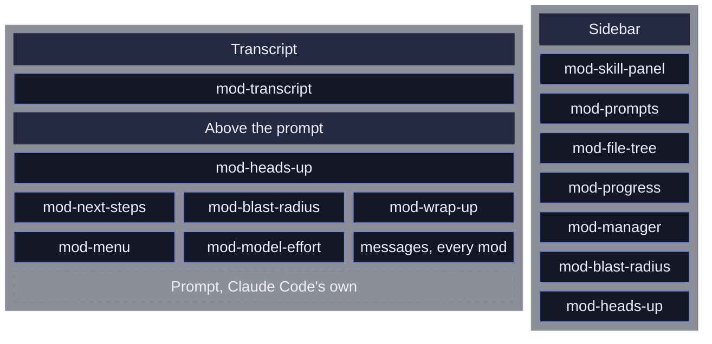
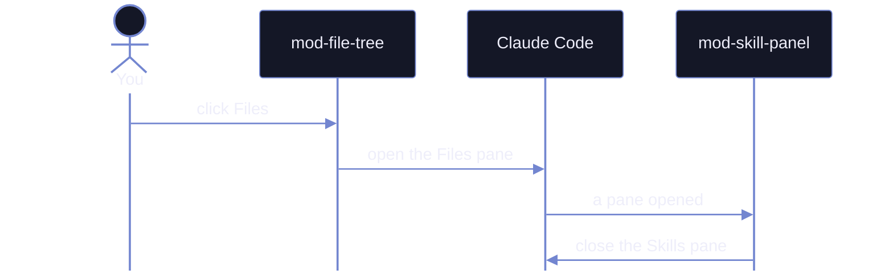

<div align="center">
  
</div>

# moonlight-claude-mods

Add-ons for Claude Code that add panels, buttons and safety checks around the prompt. They need Claude Code 2.1.287 or newer.

**Every terminal mod in 92 seconds**

https://github.com/user-attachments/assets/7e2c3727-83d1-4549-9c13-80e51a8bf929

The same session without and with the mods:

| Without mods | With mods |
| --- | --- |
|  |  |

## What each mod does

| Mod | What it does | How to open it |
| --- | --- | --- |
| `mod-menu` | One row of pills above the prompt that opens every panel | Always shown |
| `mod-manager` | Turns mods on and off and edits their settings | The gear pill, or `/mod-manager` |
| `mod-skill-panel` | Lists your skills and agents; a click adds one to the prompt | Skills pill |
| `mod-prompts` | Every prompt of the session; jump back to any of them | Prompts pill |
| `mod-file-tree` | The files Claude read and changed, with a replay of each edit | Files pill |
| `mod-transcript` | Chat bubbles for you and Claude, each finished turn folded to one line you can open, Bash commands in shell colors | Automatic |
| `mod-model-effort` | Shows the model and effort level; a click changes either | The model pill |
| `mod-heads-up` | Now and then flags one thing you should know but might miss, kept by turn in a panel | Automatic, or the Heads up pill |
| `mod-progress` | The main session and every subagent: model, effort, context fill, tokens, time and gate progress | Progress pill |
| `mod-next-steps` | Suggests up to three next prompts after each turn | Automatic |
| `mod-wrap-up` | Hands off to a fresh session, or fills `/compact` with what to keep | Wrap up pill |
| `mod-blast-radius` | Holds a risky shell command until you choose Cancel or Run | Automatic |
| `mod-collision-guard` | Asks before editing a file another session just changed | Automatic |
| `mod-desktop-status-line` | A status line for the desktop app | Desktop app only |

Where each one draws on the screen:



## See them

<!-- showcase:start -->

### mod-menu

One row of pills opens every panel. Hover one to see what it does.

| The pill row |
| --- |
| ![][img-menu-band] |

**Hovering an entry shows its tip**

https://github.com/user-attachments/assets/7bb01973-e907-4807-b571-829e65d71659

### mod-manager

Hover a mod to read about it, and switch every mod's icons at once.

| Auto (Nerd Font) | Plain |
| --- | --- |
| ![][img-manager-icons-auto] | ![][img-manager-icons-plain] |

**Hover a mod, switch the icons**

https://github.com/user-attachments/assets/4d2dd504-7a88-4183-818e-0bf9f0cfafa3

### mod-file-tree

The files Claude touches, colored by what happened to them.

| The Files panel |
| --- |
| ![][img-file-tree-panel] |

**Live while Claude works**

https://github.com/user-attachments/assets/676f590d-6596-469f-9cba-baa8e23745eb

### mod-next-steps

Up to three next prompts. Click one, or type its number, to fill the prompt.

| Three suggestions |
| --- |
| ![][img-next-steps] |

**Picking one by its digit**

https://github.com/user-attachments/assets/00b218a3-db7b-45b4-a0a9-0b195198a207

### mod-prompts

Every prompt of the session; pick one to read it again.

**Pick a prompt to read it**

https://github.com/user-attachments/assets/6fcaf366-bf6a-4a54-8856-6e80b529f11f

### mod-skill-panel

Your skills grouped by color; click one to add it to the prompt.

| Panel | Tags on slash commands | Added to the prompt |
| --- | --- | --- |
| ![][img-skill-panel] | ![][img-skill-panel-slash] | ![][img-skill-panel-added] |

| Settings |
| --- |
| ![][img-skill-panel-settings] |

**Tags while typing /, add a skill, then the settings**

https://github.com/user-attachments/assets/cd3fef1e-dea9-4a25-b110-e2a87366a7b1

### mod-transcript

Each finished turn folds to one line; open it to see every step, or copy a reply from its bottom edge. A reply that names hex colors shows them.

| Folded | Open | Copy a reply |
| --- | --- | --- |
| ![][img-transcript-folded] | ![][img-transcript-open] | ![][img-transcript-copy] |

| The colors a reply names |
| --- |
| ![][img-transcript-colors] |

**Unfolding a turn**

https://github.com/user-attachments/assets/586fba29-205c-4ea5-8ef2-7257bc629a75

### mod-model-effort

The model and its effort level, one click to change.

| The model panel |
| --- |
| ![][img-model-effort-panel] |

**Effort on hover, models on click**

https://github.com/user-attachments/assets/043dd359-6d8a-44aa-b2d4-76d51d5ec376

### mod-heads-up

Now and then, one thing you should know; every note stays in its panel.

| Card | Note |
| --- | --- |
| ![][img-heads-up-card] | ![][img-heads-up-note] |

**The panel and a note opened**

https://github.com/user-attachments/assets/4b316cb1-f289-40bc-aee4-95b6f831c437

### mod-progress

Every agent at a glance: its current step, model, effort, context, tokens, time and gates.

| The pill | The panel |
| --- | --- |
| ![][img-progress-pill] | ![][img-progress-panel] |

**Two agents running, opened from the pill**

https://github.com/user-attachments/assets/5d0136a3-24d8-48ec-ae47-8a8f87ea86bb

### mod-blast-radius

A risky command waits for your answer. Type 1, 2 or 3 into the empty prompt, or click.

| The hold card | The Details pane |
| --- | --- |
| ![][img-blast-radius-card] | ![][img-blast-radius-details] |

**A risky command held**

https://github.com/user-attachments/assets/dede1549-47e9-46ee-8ace-d13dc594e6ff

### mod-collision-guard

Another session just edited this file, so Claude asks first.

| Asking before an edit |
| --- |
| ![][img-collision-guard] |

### mod-wrap-up

Pick what carries over, then hand off or compact. Played at double speed.

| Pick what stays | The filled /compact |
| --- | --- |
| ![][img-wrap-up-card] | ![][img-wrap-up-compact] |

**Compact, start to end**

https://github.com/user-attachments/assets/0b9c9abd-03e8-4f36-9069-ae02042a809d

<!-- showcase:end -->

## Use them

| Goal | How |
| --- | --- |
| Install from GitHub | `claude plugin marketplace add v-amorim/moonlight-claude-mods`, then `claude plugin install <name>@claude-mods` |
| Try one mod in one session | `claude --plugin-dir <clone>/<name>` |
| Load them every session | Add each folder to `env.CLAUDE_CODE_PLUGIN_DIRS` in `~/.claude/settings.json`, separated by `;` on Windows and `:` elsewhere |
| Apply changes in an open session | `/reload-plugins` |
| Turn one off, or change its settings | The gear pill, or `/mod-<name> settings` |
| Pass a slash command from Git Bash | `MSYS_NO_PATHCONV=1 claude "/mod-<name> settings"`, since Git Bash rewrites `/x` into a Windows path |

> [!WARNING]
> Mods are not sandboxed: they run with your permissions.

## Build your own

<details>
<summary>Make a new mod</summary>

1. Clone the repo, then copy an existing mod's folder to `<clone>/<name>` and rename it in `plugin.json` and its test.
2. Check it with `claude plugin validate <clone>/<name>`.
3. Test it with `claude plugin test <clone>/<name>`.
4. Try it with `claude --plugin-dir <clone>/<name>`, then add its folder to `CLAUDE_CODE_PLUGIN_DIRS`.

Each mod's folder:

```
<mod-name>/
  .claude-plugin/plugin.json     manifest
  hooks/hooks.json               { "modules": ["./register.tsx"] }
  hooks/register.tsx             the hooks module
  tests/*.test.tsx               run by claude plugin test
  showcase.json                  optional: tagline, features, actions, example cards
```

</details>

<details>
<summary>The shared standard</summary>

Every mod follows the same rules:

| Rule | In short |
| --- | --- |
| Name | Plugin, folder and command share one name, `mod-<name>` |
| Shared files | Each mod carries its own copy of the shared files, so it works alone |
| Panes | Tabs, a one-line hint, then bordered sections |
| Controls | Every control is a pill; mouse only, so the prompt keeps the keyboard |
| Icons | Plain symbols everywhere, Nerd Font icons when the terminal has one |

One panel shows at a time, and no mod needs to know the others:



</details>

<!-- showcase-links:start -->
[img-blast-radius-card]: showcase/blast-radius-card.png
[img-blast-radius-details]: showcase/blast-radius-details.png
[img-collision-guard]: showcase/collision-guard.png
[img-file-tree-panel]: showcase/file-tree-panel.png
[img-heads-up-card]: showcase/heads-up-card.png
[img-heads-up-note]: showcase/heads-up-note.png
[img-manager-icons-auto]: showcase/manager-icons-auto.png
[img-manager-icons-plain]: showcase/manager-icons-plain.png
[img-menu-band]: showcase/menu-band.png
[img-model-effort-panel]: showcase/model-effort-panel.png
[img-next-steps]: showcase/next-steps.png
[img-progress-panel]: showcase/progress-panel.png
[img-progress-pill]: showcase/progress-pill.png
[img-skill-panel-added]: showcase/skill-panel-added.png
[img-skill-panel-settings]: showcase/skill-panel-settings.png
[img-skill-panel-slash]: showcase/skill-panel-slash.png
[img-skill-panel]: showcase/skill-panel.png
[img-transcript-colors]: showcase/transcript-colors.png
[img-transcript-copy]: showcase/transcript-copy.png
[img-transcript-folded]: showcase/transcript-folded.png
[img-transcript-open]: showcase/transcript-open.png
[img-wrap-up-card]: showcase/wrap-up-card.png
[img-wrap-up-compact]: showcase/wrap-up-compact.png
<!-- showcase-links:end -->

