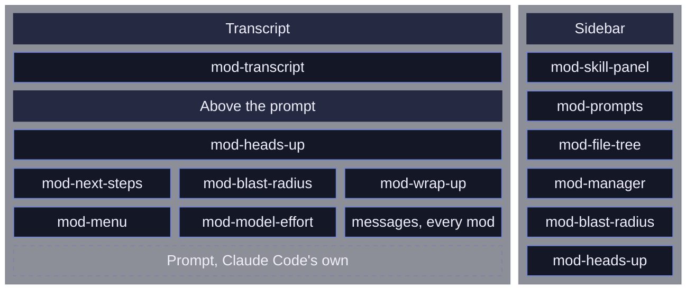
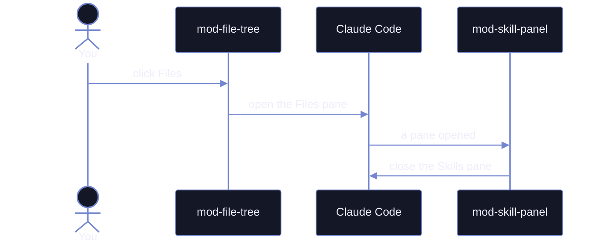

# My mods

Add-ons for Claude Code that add panels, buttons and safety checks around the prompt. They need Claude Code 2.1.287 or newer.

## What each mod does

| Mod | What it does | How to open it |
| --- | --- | --- |
| `mod-menu` | One row of pills above the prompt that opens every panel | Always shown |
| `mod-manager` | Turns mods on and off and edits their settings | The gear pill, or `/mod-manager` |
| `mod-skill-panel` | Lists your skills and agents; a click adds one to the prompt | Skills pill |
| `mod-prompts` | Every prompt of the session; jump back to any of them | Prompts pill |
| `mod-file-tree` | The files Claude read and changed, with a replay of each edit | Files pill |
| `mod-transcript` | Chat bubbles for you and Claude, each finished turn folded to one line you can open, Bash commands in shell colors | Automatic |
| `mod-model-effort` | Shows the model and effort level; a click changes either | The model pill |
| `mod-heads-up` | Now and then flags one thing you should know but might miss, kept by turn in a panel | Automatic, or the Heads up pill |
| `mod-next-steps` | Suggests up to three next prompts after each turn | Automatic |
| `mod-wrap-up` | Hands off to a fresh session, or fills `/compact` with what to keep | Wrap up pill |
| `mod-blast-radius` | Holds a risky shell command until you choose Cancel or Run | Automatic |
| `mod-collision-guard` | Asks before editing a file another session just changed | Automatic |
| `mod-desktop-status-line` | A status line for the desktop app | Desktop app only |

Where each one draws on the screen:



## See them

<!-- showcase:start -->

Click a GIF to open its full video.

### mod-menu

One row of pills opens every panel. Hover one to see what it does.

| The pill row | Hovering an entry shows its tip |
| --- | --- |
| ![][img-menu-band] | [![][gif-menu-hover]][video-menu-hover] |

### mod-manager

Hover a mod to read about it, and switch every mod's icons at once.

| Hover a mod, switch the icons | Auto (Nerd Font) | Plain |
| --- | --- | --- |
| [![][gif-manager-hover-and-icons]][video-manager-hover-and-icons] | ![][img-manager-icons-auto] | ![][img-manager-icons-plain] |

### mod-file-tree

The files Claude touches, colored by what happened to them.

| Live while Claude works | The Files panel |
| --- | --- |
| [![][gif-file-tree-live]][video-file-tree-live] | ![][img-file-tree-panel] |

### mod-next-steps

Up to three next prompts. Click one, or type its number, to fill the prompt.

| Three suggestions | Picking one by its digit |
| --- | --- |
| ![][img-next-steps] | [![][gif-next-steps-keys]][video-next-steps-keys] |

### mod-prompts

Every prompt of the session; pick one to read it again.

| Pick a prompt to read it |
| --- |
| [![][gif-prompts-pick]][video-prompts-pick] |

### mod-skill-panel

Your skills grouped by color, and the panel's settings.

| Skills, then the settings | Panel | Settings |
| --- | --- | --- |
| [![][gif-skill-panel-and-settings]][video-skill-panel-and-settings] | ![][img-skill-panel] | ![][img-skill-panel-settings] |

### mod-transcript

Each finished turn folds to one line; open it to see every step, or copy a reply from its bottom edge.

| Unfolding a turn | Folded | Open |
| --- | --- | --- |
| [![][gif-transcript-unfold]][video-transcript-unfold] | ![][img-transcript-folded] | ![][img-transcript-open] |

| Copy a reply |
| --- |
| ![][img-transcript-copy] |

### mod-model-effort

The model and its effort level, one click to change.

| Effort on hover, models on click | The model panel |
| --- | --- |
| [![][gif-model-effort-pick]][video-model-effort-pick] | ![][img-model-effort-panel] |

### mod-heads-up

Now and then, one thing you should know; every note stays in its panel.

| The panel and a note opened | Card | Note |
| --- | --- | --- |
| [![][gif-heads-up-panel]][video-heads-up-panel] | ![][img-heads-up-card] | ![][img-heads-up-note] |

### mod-blast-radius

A risky command waits for your answer. Type 1, 2 or 3 into the empty prompt, or click.

| A risky command held | The hold card | The Details pane |
| --- | --- | --- |
| [![][gif-blast-radius-hold]][video-blast-radius-hold] | ![][img-blast-radius-card] | ![][img-blast-radius-details] |

### mod-collision-guard

Another session just edited this file, so Claude asks first.

| Asking before an edit |
| --- |
| ![][img-collision-guard] |

### mod-wrap-up

Pick what carries over, then hand off or compact. Played at double speed.

| Compact, start to end | Pick what stays | The filled /compact |
| --- | --- | --- |
| [![][gif-wrap-up-full]][video-wrap-up-full] | ![][img-wrap-up-card] | ![][img-wrap-up-compact] |

<!-- showcase:end -->

## Use them

| Goal | How |
| --- | --- |
| Try one mod in one session | `claude --plugin-dir ~/.claude/mods/<name>` |
| Load them every session | Add each folder to `env.CLAUDE_CODE_PLUGIN_DIRS` in `~/.claude/settings.json`, separated by `;` on Windows and `:` elsewhere |
| Apply changes in an open session | `/reload-plugins` |
| Turn one off, or change its settings | The gear pill, or `/mod-<name> settings` |

> [!WARNING]
> Mods are not sandboxed: they run with your permissions.

## Build your own

<details>
<summary>Make a new mod</summary>

1. Ask the `mod-builder` agent, or copy `~/.claude/skills/mod-builder/templates/cli-mod` to `~/.claude/mods/<name>` and rename it in `plugin.json` and its test.
2. Check it with `claude plugin validate ~/.claude/mods/<name>`.
3. Test it with `claude plugin test ~/.claude/mods/<name>`.
4. Try it with `--plugin-dir`, then add it to `CLAUDE_CODE_PLUGIN_DIRS`.

Each mod's folder:

```
<mod-name>/
  .claude-plugin/plugin.json     manifest
  hooks/hooks.json               { "modules": ["./register.tsx"] }
  hooks/register.tsx             the hooks module
  tests/*.test.tsx               run by claude plugin test
  showcase.json                  optional: tagline, features, actions, example cards
```

The guides live in `~/.claude/skills/mod-builder/`.

</details>

<details>
<summary>The shared standard</summary>

Every mod follows `~/.claude/skills/mod-builder/references/standard.md`:

| Rule | In short |
| --- | --- |
| Name | Plugin, folder and command share one name, `mod-<name>` |
| Shared files | Each mod carries its own copy of the shared files, so it works alone |
| Panes | Tabs, a one-line hint, then bordered sections |
| Controls | Every control is a pill; mouse only, so the prompt keeps the keyboard |
| Icons | Plain symbols everywhere, Nerd Font icons when the terminal has one |

One panel shows at a time, and no mod needs to know the others:



</details>

<!-- showcase-links:start -->
[gif-blast-radius-hold]: showcase/gif/blast-radius-hold.gif
[gif-file-tree-live]: showcase/gif/file-tree-live.gif
[gif-heads-up-panel]: showcase/gif/heads-up-panel.gif
[gif-manager-hover-and-icons]: showcase/gif/manager-hover-and-icons.gif
[gif-menu-hover]: showcase/gif/menu-hover.gif
[gif-model-effort-pick]: showcase/gif/model-effort-pick.gif
[gif-next-steps-keys]: showcase/gif/next-steps-keys.gif
[gif-prompts-pick]: showcase/gif/prompts-pick.gif
[gif-skill-panel-and-settings]: showcase/gif/skill-panel-and-settings.gif
[gif-transcript-unfold]: showcase/gif/transcript-unfold.gif
[gif-wrap-up-full]: showcase/gif/wrap-up-full.gif

[img-blast-radius-card]: showcase/blast-radius-card.png
[img-blast-radius-details]: showcase/blast-radius-details.png
[img-collision-guard]: showcase/collision-guard.png
[img-file-tree-panel]: showcase/file-tree-panel.png
[img-heads-up-card]: showcase/heads-up-card.png
[img-heads-up-note]: showcase/heads-up-note.png
[img-manager-icons-auto]: showcase/manager-icons-auto.png
[img-manager-icons-plain]: showcase/manager-icons-plain.png
[img-menu-band]: showcase/menu-band.png
[img-model-effort-panel]: showcase/model-effort-panel.png
[img-next-steps]: showcase/next-steps.png
[img-skill-panel-settings]: showcase/skill-panel-settings.png
[img-skill-panel]: showcase/skill-panel.png
[img-transcript-copy]: showcase/transcript-copy.png
[img-transcript-folded]: showcase/transcript-folded.png
[img-transcript-open]: showcase/transcript-open.png
[img-wrap-up-card]: showcase/wrap-up-card.png
[img-wrap-up-compact]: showcase/wrap-up-compact.png

[video-blast-radius-hold]: showcase/blast-radius-hold.mp4
[video-file-tree-live]: showcase/file-tree-live.mp4
[video-heads-up-panel]: showcase/heads-up-panel.mp4
[video-manager-hover-and-icons]: showcase/manager-hover-and-icons.mp4
[video-menu-hover]: showcase/menu-hover.mp4
[video-model-effort-pick]: showcase/model-effort-pick.mp4
[video-next-steps-keys]: showcase/next-steps-keys.mp4
[video-prompts-pick]: showcase/prompts-pick.mp4
[video-skill-panel-and-settings]: showcase/skill-panel-and-settings.mp4
[video-transcript-unfold]: showcase/transcript-unfold.mp4
[video-wrap-up-full]: showcase/wrap-up-full.mp4
<!-- showcase-links:end -->
